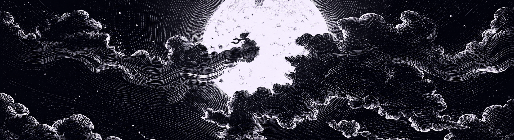
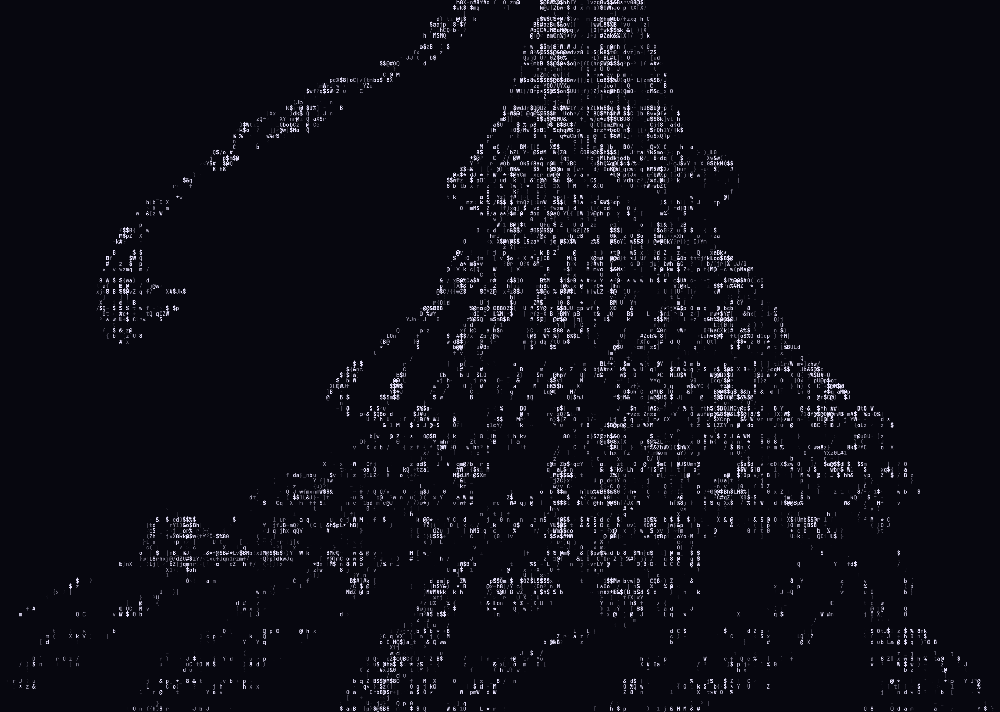
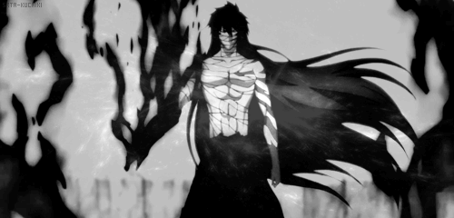

<h1 align="center">NEO INC</h1>

  

SOFTWARES · SYSTEMS · IDEAS · BEYOND

<table cellpadding="0" cellspacing="0" border="0">
<tr>
<td width="50%" valign="middle" align="center" bgcolor="#07070F">

</td>
<td width="50%" valign="middle" bgcolor="#07070F">

<pre>
┌─[ ogsway@github ]
└─$ neofetch

USER      ogsway
ROLE      Independent Developer
FOCUS     Systems / Open Source
PROJECT   Neo OS
STATE     In development

┌─[ active project ]
└─$ cat neo-os.txt

NAME      Neo OS
TYPE      Independent OS project
GOAL      Explore system architecture,
          Linux technologies, and a
          custom computing environment.
STATUS    Building in public
</pre>

</td>
</tr>
</table>

---

## TECHNOLOGIES

  
  
  
  
  
  
  

---

## PROJECTS

<table>
<tr>
<td width="33%" valign="top" align="center">

<u>IN DEVELOPMENT</u>

Operating-system project focused on performance, personalization, and user freedom.

</td>
<td width="33%" valign="top" align="center">

<u>PLANNED</u>

Future security project exploring digital protection for systems and networks.

</td>
<td width="33%" valign="top" align="center">

<u>PLANNED</u>

Future AI project envisioned as part of the Neo ecosystem, with a focus on useful tools and automation.

</td>
</tr>
</table>

---

## ABOUT

Developing systems, tools, and ideas through software and open-source technologies. **Neo Inc** is the space where I explore technology, keep learning, and build projects around minimalism, functionality, and freedom.

---

## STATISTICS

<table>
<tr>
<td width="50%" valign="middle" align="center" bgcolor="#07070F">

</td>
<td width="50%" valign="middle">

  

</td>
</tr>
</table>

---

## CONTACT

  
  

---

  NEO INC / SYSTEMS / OPEN SOURCE 
  <em>Build technology. Shape the future.</em>

